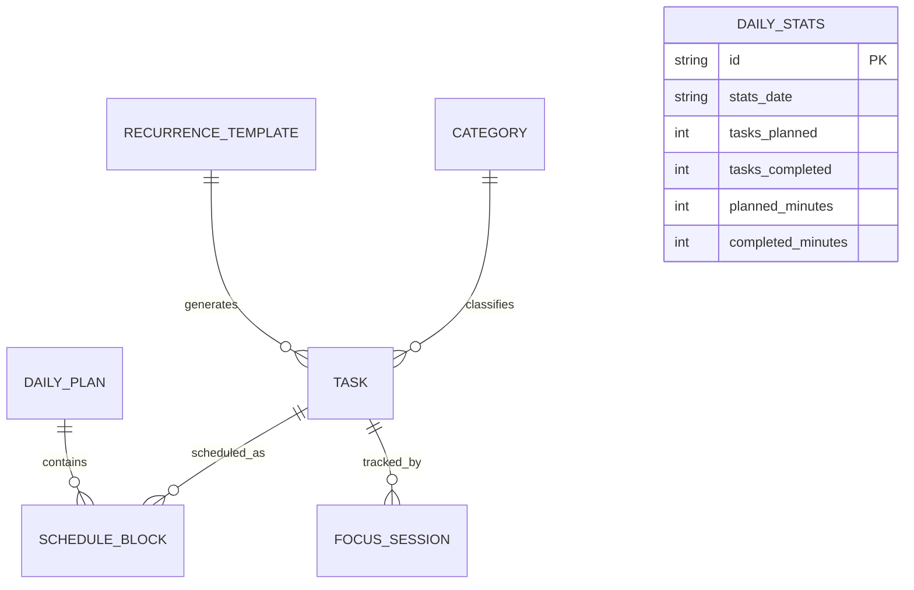

# Database schema

Drift is the only persistence API; domain classes never expose Drift rows. IDs are UUID text. Dates are ISO-8601 calendar dates (YYYY-MM-DD); times are integer minutes after local midnight. All timestamps are UTC ISO-8601 text.

## Tables

| Table | Primary key | Key columns and constraints | Indexes / relationships |
|---|---|---|---|
| `categories` | `id TEXT` | `name TEXT NOT NULL UNIQUE`, `icon TEXT NOT NULL` | Fixed rows seeded idempotently on open/create. |
| `recurrence_templates` | `id TEXT` | title, nullable description/category, `priority INTEGER NOT NULL DEFAULT 2 CHECK(1..3)`, `estimated_duration_minutes INTEGER NOT NULL`, preferred window, nullable energy, recurrence type, `recurrence_days TEXT NOT NULL`, start/end dates, timestamps | `category_id → categories ON DELETE SET NULL`; Phase 1.5 schema ready. Recurrence days stored as JSON array. |
| `tasks` | `id TEXT` | title, nullable description/category, priority, estimated/actual minutes/seconds, lifecycle status, nullable due date, preferred window, nullable energy/template, timestamps/completed timestamp | `category_id → categories ON DELETE SET NULL`; `recurrence_template_id → recurrence_templates ON DELETE SET NULL`; indexes `(status)`, `(due_date)`, `(category_id)`. |
| `daily_plans` | `id TEXT` | `plan_date TEXT NOT NULL UNIQUE`, available start/end minute, planned/completed minutes | `CHECK(available_start < available_end)`; index `plan_date`. |
| `schedule_blocks` | `id TEXT` | `plan_date`, start/end minute, `block_type`, nullable task, `source`, timestamps | `CHECK(start < end)`; `CHECK((block_type='task' AND task_id IS NOT NULL) OR (block_type='break' AND task_id IS NULL))`; task_id FK on delete CASCADE. Indexes `(plan_date, start_minute)`, `(task_id, plan_date)`. |
| `daily_stats` | `id TEXT` | `stats_date TEXT NOT NULL UNIQUE`, task counts, planned/completed/overloaded minutes, rollover count, timestamps | **No foreign key to tasks**; durable independent historical snapshot that survives task deletion. Non-negative numeric checks; index `stats_date`. |
| `focus_sessions` | `id TEXT` | task id, state, started/paused/ended timestamps, accumulated active seconds, timestamps | `task_id → tasks ON DELETE CASCADE`; indexes `(task_id)`, `(state)`. Recovers execution tracking across restarts. |

## Enums and converters

Stored lowercase strings for `task_status` (`pending`, `scheduled`, `inProgress`, `completed`, `cancelled`), `preferred_time_window` (`anytime`, `morning`, `afternoon`, `evening`), energy (`low`, `medium`, `high`), recurrence (`daily`, `weekly`), block type (`task`, `break`), and source (`automatic`, `manual`). Priority is integer `1..3`.

## Integrity and migrations

- Repositories transact and reject overlapping blocks for the same date.
- During re-plan, `replaceAutomaticBlocks` deletes only blocks where `source = 'automatic'` and strictly preserves all `source = 'manual'` blocks.
- Fixed default categories are seeded idempotently in `onCreate` and `beforeOpen`.
- Migrations use explicit versioned steps preserving user data.

