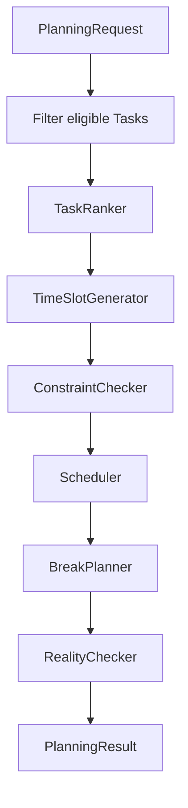

# Planning Engine

The engine is a deterministic, pure domain service. It receives a `PlanningRequest` (date, one available range, eligible Tasks, existing blocks, break duration) and returns proposed blocks, unscheduled task IDs, and a Reality Check. It neither reads Drift nor mutates repositories.

## Pipeline and contracts

`TaskRanker`, `TimeSlotGenerator`, `ConstraintChecker`, and `PlanningEngine` are defined in `lib/core/planning/planning_contracts.dart`. Add `Scheduler`, `BreakPlanner`, and `RealityChecker` behind the same pure boundary before Sprint 5 implementation.

## Rules

1. Eligible tasks are pending/scheduled only; completed and cancelled are excluded. Existing manual blocks reserve time and are never moved by an automatic re-plan.
2. Rank by due-today first, priority descending, then preferred-window fit, energy-curve fit, duration fit, then user creation order. The latter three are tie-break/selection preferences; deadline and priority win direct conflicts.
3. Generate continuous free slots by subtracting existing blocks from the one available range. Reject malformed/overlapping input before placement.
4. Try each ranked task in the earliest continuous slot large enough. Try its preferred window first, then any slot. Never split a task.
5. Generate a 15-minute break after a continuous focus block of at least 90 minutes, only where it can be added after the task without overlap. Breaks do not increase planned task minutes. If a break does not fit, retain the task and report this condition; whether it may extend the available day is unresolved.
6. Preserve manual authority: an existing manual block for a task is retained; automatic blocks for that task/date are replaced, never duplicated.
7. Reality Check compares total requested/planned task minutes to available minutes and identifies unscheduled work. Its Keep/Move suggestions sort non-due-today tasks by low priority first, then longer duration.

## Edge cases

| Case | Expected Phase 1 behavior |
|---|---|
| No tasks | Empty blocks; zero overload. |
| No available time | No automatic blocks; all eligible tasks unscheduled. |
| One task longer than day / every slot | Unscheduled; Reality Check surfaces it. |
| All tasks fit | Schedule ranked tasks earliest valid slots; insert eligible breaks. |
| Partial fit | Schedule only fitting tasks; leave others unscheduled. |
| Multiple high-priority or due-today conflicts | Stable rank then user entry order resolves ties. |
| Preferred-time or energy mismatch | Use a valid alternative slot; these are soft preferences. |
| Existing manual block | Reserve it and do not auto-move it. |
| Overlapping existing blocks | Reject as invalid repository input; do not produce an ambiguous plan. |
| Exact duration fit | Use the complete slot. |
| Completed/cancelled task | Exclude. |
| In-progress overdue task | Keep its block; UI derives overdue; do not shift future blocks. |
| Manually rescheduled task | Manual block wins; prevent an automatic duplicate. |
| Overloaded day | Keep realistic placement; present suggestions, never force all tasks in. |

## Open Technical Decisions

- Whether break insertion can leave a 90+ minute manual block untouched (recommended) versus proposing a separate optional break.
- Whether a scheduled-but-unstarted automatic block is included as an engine candidate or first deleted/replaced; recommended: replace only blocks sourced `auto` for the requested date.
- Exact semantic of `plannedMinutes`: currently specified as daily task planning aggregate; it should exclude breaks.
