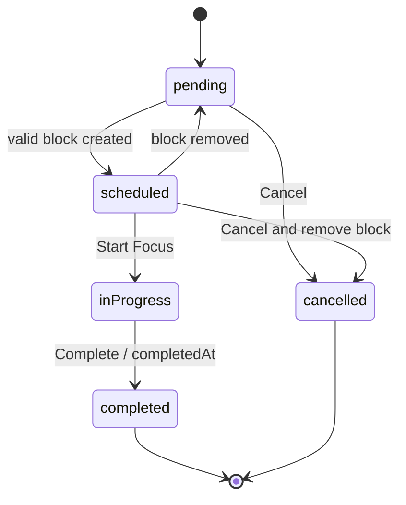

# Task lifecycle

`overdue` and `rescheduled` are not persisted Task statuses. Overdue is derived when an `inProgress` task’s scheduled end is earlier than now. Rescheduling is a ScheduleBlock replacement event.

The specification does not define reopening completed/cancelled tasks; prohibit it in Phase 1. Do not automatically move incomplete tasks at day end: remove/expire their ScheduleBlock and leave the task pending with no date.
